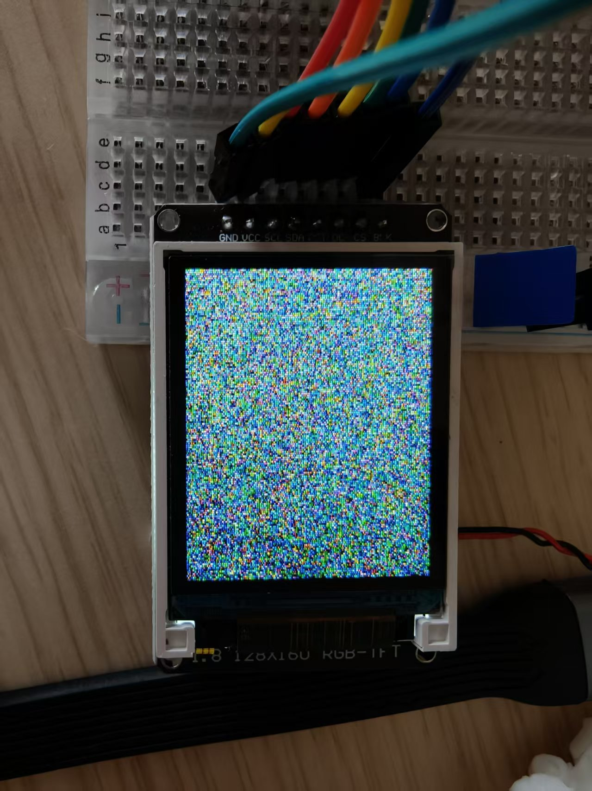
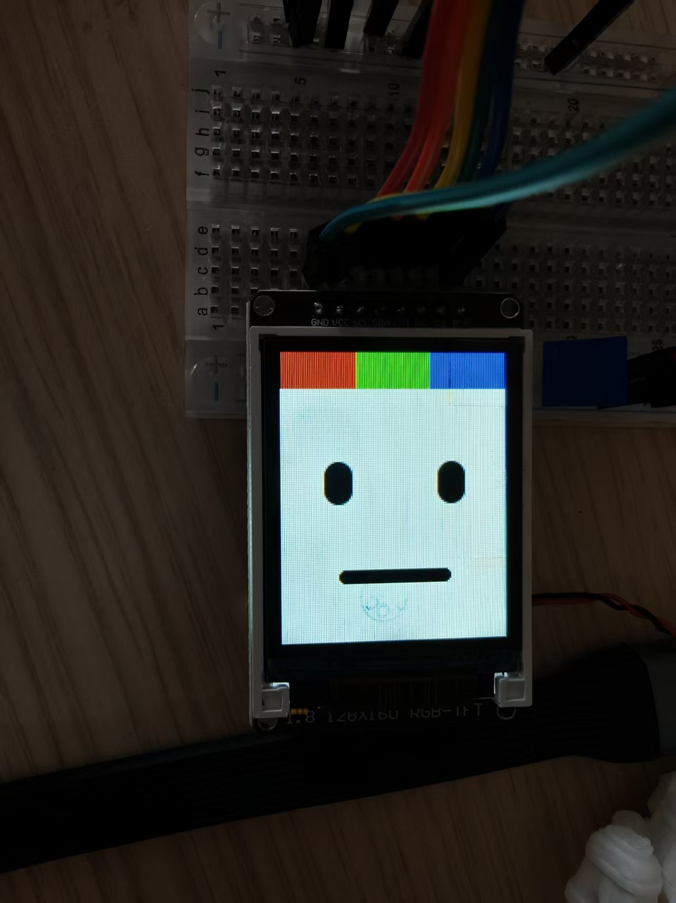
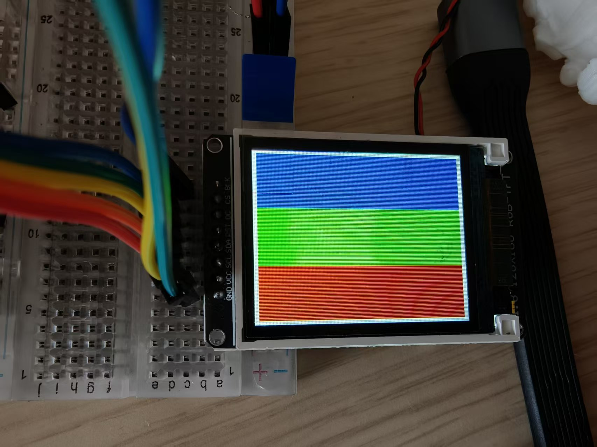

# Cubie A7Z ST7735 与 LVGL 适配

本适配复用 openvela/NuttX 官方 `drivers/lcd/st7735.c`，板级代码只负责
A733 SPI1、D/C 和 RESET 接线。应用通过标准 `/dev/lcd0` 和 LVGL NuttX LCD
后端访问屏幕，没有引入 Linux `spidev` 或 Python 运行时依赖。

## 已验证硬件与接线

| ST7735 | Cubie A7Z | 物理引脚 |
| --- | --- | --- |
| VCC | 3.3 V | 1 或 17 |
| GND | GND | 任一 GND |
| SCK | PD11 / SPI1_CLK | 23 |
| MOSI | PD12 / SPI1_MOSI | 19 |
| CS | PD10 / SPI1_CS0 | 24 |
| DC | PL5 / R_PIO GPIO | 22 |
| RST | PB0 / GPIO | 7 |
| BL | 3.3 V | 1 或 17 |

MISO 不连接。屏幕为 1.8 英寸 128×160 ST7735，SPI Mode 0，RGB565。
当前 A733 polling lower-half 将频率限制为 12 MHz。

## 软件层次

```text
A733 SPI1 lower-half + SPI_CMDDATA(PL5)
  -> 官方 st7735.c
  -> lcd_dev_s 和 /dev/lcd0
  -> 官方 LVGL NuttX LCD backend
  -> 桌宠 UI
```

`a7z_st7735.c` 是板级 glue，通用控制器逻辑仍由官方驱动维护。SPI1
lower-half 同时支持 8-bit 命令和高字节优先的 16-bit RGB565 像素传输。

## 构建

在完整 openvela 工作区根目录对应的比赛仓库中执行：

```bash
bash contest2026_274_Dogking/tools/build-a733.sh
```

构建脚本只在构建期间暂存 overlay，并在退出时恢复官方工作区。

本阶段已完成 WSL 全量构建、最终 ELF 符号检查和镜像内核回读校验。构建结果：

```text
build: quickly-openvela/cmake_out/cubie-a7z_nsh_v120_st7735
nuttx.bin: 2183008 bytes
nuttx.bin SHA-256: f3871b2422ba000e14df016197fe2a09217a58f03f873e62b4e5084c73700eb7
```

可烧录候选镜像（不提交到 Git）：

```text
A733-A7Z-ALL-Files/openvela-a733-cubie-a7z-sd-st7735-lvgl-v120-candidate.img
size: 2147483648 bytes
SHA-256: 6bececd77790eba146de0ef5762a2ec11b296a9665fb08f7f9fe24e67024941c
```

上述 v120 记录保留用于历史回溯。当前 v122 修复版为：

```text
build: quickly-openvela/cmake_out/cubie-a7z_nsh_v121_display_i2s
nuttx.bin: 2187160 bytes
nuttx.bin SHA-256: bedf575b3905ae71c3ffb3ef53ad93becb3f3c9823d52677de4e9a8746508fbd
image: A733-A7Z-ALL-Files/openvela-a733-cubie-a7z-sd-st7735-i2s-v122-candidate.img
image bytes: 2147483648
image SHA-256: 83e4f1fb3cf002e35366032e8ef5c53c76904e089f5d1b8db82a69cea282a3b2
```

镜像已经通过 ext4、GPT、内嵌内核大小及 SHA-256 回读校验。编译和封装成功不等于
面板实机验收完成；首次烧录后仍需执行下一节命令确认接线、方向和颜色。

## v122 修复内容

早期候选版能够点亮背光或短暂显示，但在整屏刷新时可能停住。此次修复把问题
拆成硬件链路和 LVGL 两层：

- 主 CCU 基址从错误的 `0x02001000` 改为 A733 的 `0x02002000`，使 SPI1
  模块时钟配置真正生效。
- 写屏传输启用 SPI 的 RX 丢弃模式；ST7735 没有连接 MISO，写操作不能继续
  等待不存在的回读数据。
- 每个 SPI 块改为等待真实的 transfer-complete 位，并检测 FIFO/传输错误；
  所有等待都有 100 ms 上限，外设异常不再永久卡死系统。
- 使用此前 Linux 实机通过的 ST7735 上电、帧率、电源和 gamma 初始化序列，
  后续窗口、方向与 RGB565 传输仍由官方 NuttX ST7735 驱动负责。
- LCD 改为命令首次使用时初始化，失败只影响显示，不影响 Wi-Fi、Agent、SSH
  或系统启动。
- 新增 `display raw`，它绕过 LVGL 直接调用标准 LCD lower-half 绘制白框和
  RGB 三色条，可快速定位问题在 SPI/面板层还是 LVGL 层。
- 通用 ST7735 fill 改为整行批量发送，避免逐像素 SPI 事务。

## 首次上板检查

上电前再次核对 3.3 V、GND、DC 和 RESET，禁止把屏幕接到 5 V 信号。
启动后检查：

```text
dmesg
ls /dev/lcd0
display status
display raw
display test 30
display run
```

预期日志包含：

```text
A733: ST7735 LCD ready at /dev/lcd0 (0)
```

首次启动时 `/dev/lcd0` 尚不存在是正常现象；执行 `display raw`、
`display test` 或 `display run` 会按需创建。`display raw` 应先稳定显示白色边框
和红绿蓝三条色带；它通过后再运行 `display test 30` 验证官方 LVGL NuttX LCD
后端。`display run` 持续运行，按 `Ctrl+C` 退出。

若画面方向正确但红蓝互换，切换 `CONFIG_LCD_ST7735_BGR` 后重新构建；
若屏幕整体镜像，调整 `CONFIG_LCD_RPORTRAIT`。这两个选项只描述面板差异，
不应在应用层交换颜色或坐标。

## 桌宠接入约束

- 所有 LVGL API 由单一 UI 线程调用。
- Agent、ASR、TTS 和本地 LLM 只向 UI 消息队列发送状态事件。
- 情绪状态应保持到下一次明确更新，避免每句文本完成后闪回 idle。
- 首版使用局部刷新与约 10～15 FPS 动画；DMA/FIFO 优化应保持为后续独立改动。

## 当前验收边界

- 已完成：A733 SPI1、写单工传输修复、`SPI_CMDDATA`、板级复位和初始化序列、
  官方 ST7735、按需 `/dev/lcd0`、官方 LVGL NuttX LCD backend、raw 分层测试。
- 待真机：v123 的 raw 色条、LVGL 连续刷新、RGB/BGR、方向和实际帧率。
- 待产品层：将桌宠 Agent 的情绪/动作事件接入单一 LVGL UI 线程。

## v122 实机失败与 v123 修复

v122 上 `display raw` 打印 `ST7735 ready at /dev/lcd0` 后没有自行返回，用户按
`Ctrl+C` 才回到 NSH；`display test 30` 同样卡死且 `Ctrl+C` 无效，屏幕始终
无显示。因此 v122 **没有通过 raw 测试**，不能把人工中止记作成功。

早期曾把 Linux SPI core 的 `set_cs()` 布尔参数误当成控制器寄存器的物理电平，
因而得出了“`SS_LEVEL` 置位时选中”的错误结论。后续与仓库中唯一有实体面板
响应的版本及 A733 寄存器定义交叉核对，确认硬件 CS0 为低有效：选择时必须清
`SS_LEVEL`，释放时置位。该历史错误已在 v126 中纠正。

v123 当时做了以下尝试（其中片选结论后来被 v126 推翻）：

- 选择 ST7735 时置 `SS_LEVEL`，释放时清零，与厂商控制器驱动一致；
- SPI FIFO/传输等待上限降为 20 ms；首次错误锁存，当前整屏操作的后续块直接
  跳过，避免数百次超时累积；
- `display raw` 与 LVGL 循环读取并报告底层 SPI 错误，失败时应快速返回 NSH；
- 每次显式初始化前清理 FIFO、ISR 和旧错误锁存，允许修正接线后重新测试。

v123 构建及封装信息：

```text
build: quickly-openvela/cmake_out/cubie-a7z_nsh_v123_display_i2s_fix
nuttx.bin bytes: 2187176
nuttx.bin SHA-256: 2d4a3ee5cf088d5dae116d1d7d263e22d35a3b965a9f00de91890f7eca0a7b1a
image: A733-A7Z-ALL-Files/openvela-a733-cubie-a7z-sd-st7735-i2s-v123-fix-candidate.img
image bytes: 2147483648
image SHA-256: 8725bf5063edc8cb97c003ce4a11e598ae1a29d52b57bb66b33f63da0b9721c0
```

v123 首轮复测先只运行 `display raw`。成功时必须显示色带并打印
`display: raw LCD path passed` 后自动返回；若失败，应在很短时间内打印明确的
`SPI error`，此时保存输出和 `dmesg`，不要继续运行 `display test`。

## v126：恢复低有效 CS，并强制 8 位 RGB565 字节流

用户提供的实体照片证明官方仓库对应版本是所有历史版本中唯一能使面板显示图形的
版本。画面中的五官轮廓和背景均可辨认，但整屏出现等间距细竖线、颜色异常和旧画面
残留。这组现象同时给出两个关键证据：SPI 引脚、D/C、RESET 和基本初始化至少曾经
工作；面板像素格式或 RGB565 字节流仍不正确。

v126 因此不再继续修改 I2S，也不依赖通用 LCD lower-half 的 16 位 SPI 语义，而是
建立最短、可观测的 ST7735 路径：

- 恢复唯一有屏幕反应版本的低有效 CS 行为：选中时清 `SS_LEVEL`，释放时置位；
- 初始化阶段明确发送 `COLMOD=0x05`，强制 ST7735 使用 16-bit RGB565，避免面板
  仍按 18-bit/3-byte 像素解释数据而形成周期性竖条；
- 使用 Linux 实机版本已经验证过的 `MADCTL=0xc0` 和 128×160、零偏移窗口；
- 命令、参数和像素全部以 SPI 8-bit word 发送；每个 RGB565 像素显式序列化为
  高字节、低字节，彻底消除 16-bit SPI word 与 CPU 小端存储之间的歧义；
- `display raw8` 直接输出白色边框和红、绿、蓝三块竖向色带；
- LVGL flush 复用同一条 direct-8-bit 写区路径，raw8 通过后才有资格测试 LVGL。

构建和封装结果：

```text
build: quickly-openvela/cmake_out/cubie-a7z_nsh_v126_st7735_raw8
nuttx.bin bytes: 2183104
nuttx.bin SHA-256: 88f97d3cb8eabe85f6016a657686d316afa26611ff16e34db0141d4c22ae35c7
image: openvela-a733-cubie-a7z-sd-st7735-v126-raw8-cs-fix-candidate.img
image bytes: 2147483648
image SHA-256: f173ad215c58486e52fc315577666375013fbda6528ec6ecaa350ab63ef73042
embedded kernel SHA-256: 88f97d3cb8eabe85f6016a657686d316afa26611ff16e34db0141d4c22ae35c7
ext4: clean
GPT: no problems found
```

首次上板只执行：

```text
display status
display raw8
```

`raw8` 必须自动返回，并显示完整白框以及无竖条的红、绿、蓝三块色带。只有这一步
通过后才能执行 `display test 30`。

### v126 实机验收结果（2026-09-27）

上述门禁已经全部通过：

- `display status` 初始化 direct 8-bit path 并报告 `direct=ready`；
- `display raw8` 连续两次打印 `raw8 path passed` 并自动返回 NSH；
- 实体屏显示完整白框和纯红、纯绿、纯蓝三块色带，颜色、边界和全屏寻址正确；
- `display test 30` 显示完整 LVGL 桌宠脸部，持续 30 秒后返回 NSH；
- 测试后的 `dmesg` 没有 SPI timeout、FIFO overflow、Data Abort 或堆损坏。

实机照片：







第一张照片是首次完整写屏前的面板 GRAM 随机内容；随后的 raw8/LVGL 全帧写入均
正确。它不再属于链路失败，但产品启动阶段应增加一次黑屏清除，避免用户看到随机
GRAM。当前功能等级为 **hardware-passed**；30 秒测试不足以声明 stress-passed。

## v127：正式桌宠 LVGL 场景与 Agent 联动

v127 不再修改已经通过实机验收的 SPI/ST7735 层。它在单一 LVGL 所有者任务中加入
七类程序化表情、眨眼和 10 秒回闲，并用非阻塞 POSIX 消息队列接收 Agent 情绪。
面板第一次初始化后还会先清黑整块 GRAM，避免首次完整刷新前显示随机像素。

完整命令、架构边界、制品哈希和测试门禁见 `docs/LVGL_PET_UI.md`。该增量已经通过
完整构建与镜像校验。v127 实机确认首帧和情绪事件到达，但因 LVGL tick 未推进，
实体屏保持普通表情。v128 补齐 `lv_tick_inc(delay)` 后，实机确认七种表情连续切换、
手动情绪消息及 AIPET 请求开始“思考”/回复完成情绪联动全部生效。显示产品链路现为
hardware-passed；v126 的底层通过结论不受影响，长时间压力测试仍待完成。

## v123 实机定位与 v124 FIFO 修复

v123 的快速失败机制生效，`display raw` 不再永久卡住，但返回：

```text
A733 SPI1: transfer error isr=00000473 fsr=00430000
display: raw row 0 failed: -5
```

`ISR bit 10` 是 TX FIFO overflow，`FSR` 同时显示 TX FIFO 计数为 67。代码对
63 字节分块逐项调用 `putreg32(TXD)`，而厂商 Linux 驱动对 FIFO 数据口明确使用
`writeb/readb`；32 位访问会错误推进多个 FIFO lane。v124 改用
`putreg8/getreg8`，并把错误掩码限定为厂商定义的 RX overflow、RX underrun 与
TX overflow 三项。

```text
build: quickly-openvela/cmake_out/cubie-a7z_nsh_v124_spi_fifo_i2s_map
nuttx.bin bytes: 2191296
nuttx.bin SHA-256: c464c3c43fbbbaad5aa6aa98d234bae217c577e39fab092b3470618ef7276758
image: A733-A7Z-ALL-Files/openvela-a733-cubie-a7z-sd-st7735-i2s-v124-fifo-map-fix-candidate.img
image bytes: 2147483648
image SHA-256: 275fe9a413af02d275e4738e6d2bd0b1a1807b11c27853cded975f19408d6522
```
